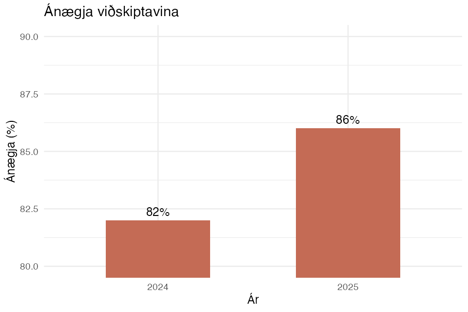
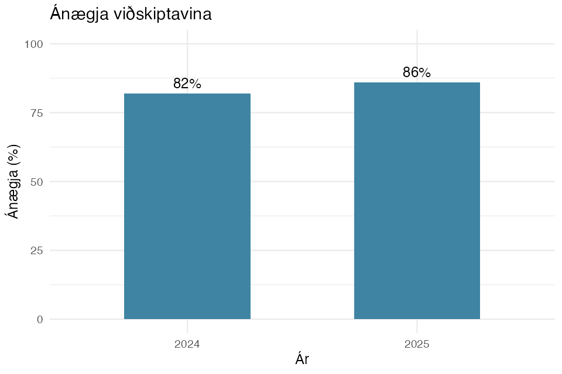

# Prófaðu þekkingu þína

Í þessum gagnvirku æfingum æfir þú þig í að þekkja
villandi myndræna framsetningu gagna.

Þú færð að skoða gröf, finna hvað mætti betur fara
og sjá hvernig hægt er að setja sömu gögn fram á
skýrari og áreiðanlegri hátt.

Æfingarnar byggja á námsefni kaflans
**Slæm myndræn framsetning**.

## Æfing 1 – Graf sem byrjar ekki á 0

Horfðu á grafið hér fyrir neðan og veldu hvað er helst villandi við framsetninguna.



```{=html}
<div id="villa-q1" class="villa-card">
  <label class="villa-option">
    <input type="radio" name="villa1" value="A">
    <span>A. Litirnir eru of skærir</span>
  </label>

  <label class="villa-option">
    <input type="radio" name="villa1" value="B">
    <span>B. Y-ásinn byrjar ekki á 0 og ýkir muninn</span>
  </label>

  <label class="villa-option">
    <input type="radio" name="villa1" value="C">
    <span>C. Það eru of fá gögn í grafinu</span>
  </label>

  <label class="villa-option">
    <input type="radio" name="villa1" value="D">
    <span>D. Súlurnar ættu að vera láréttar</span>
  </label>

  <button type="button" id="villa-check-1">Athuga svar</button>

  <div id="villa-feedback-1" aria-live="polite"></div>

  <div id="villa-correct-chart-1" style="display:none; margin-top: 20px;">
    <p><strong>Skýrari framsetning á sömu gögnum:</strong></p>
    
  </div>
</div>
```

<style>
.villa-card {
  background: var(--bs-tertiary-bg, #f7f8fa);
  border: 1px solid var(--bs-border-color, #ddd);
  border-radius: 14px;
  padding: 24px;
  margin: 24px 0;
}

.villa-option {
  display: flex;
  gap: 12px;
  align-items: center;
  padding: 14px;
  margin: 10px 0;
  border: 1px solid var(--bs-border-color, #ccc);
  border-radius: 10px;
  cursor: pointer;
}

.villa-option:has(input:checked) {
  border-color: #397fc2;
  background: rgba(57, 127, 194, 0.1);
}

.villa-option input {
  accent-color: #397fc2;
}

#villa-check-1 {
  background: #2463a4;
  color: white;
  border: none;
  border-radius: 9px;
  padding: 12px 22px;
  cursor: pointer;
  margin-top: 14px;
  font-weight: 600;
}

#villa-feedback-1 {
  margin-top: 18px;
  padding: 18px;
  border-radius: 10px;
  white-space: pre-line;
  line-height: 1.7;
}

#villa-feedback-1.correct {
  background: rgba(38, 148, 89, 0.1);
  border: 1px solid #269459;
}

#villa-feedback-1.incorrect {
  background: rgba(203, 72, 56, 0.1);
  border: 1px solid #cb4838;
}

#villa-correct-chart-1 img {
  max-width: 100%;
  height: auto;
  border-radius: 10px;
  border: 1px solid var(--bs-border-color, #ddd);
}
</style>

<script>
document.getElementById("villa-check-1").addEventListener("click", () => {
  const selected = document.querySelector('input[name="villa1"]:checked');
  const feedback = document.getElementById("villa-feedback-1");
  const correctChart = document.getElementById("villa-correct-chart-1");

  if (!selected) {
    feedback.className = "incorrect";
    feedback.textContent = "Veldu svar áður en þú heldur áfram.";
    correctChart.style.display = "none";
    return;
  }

  const isCorrect = selected.value === "B";
  feedback.className = isCorrect ? "correct" : "incorrect";

  feedback.textContent =
    (isCorrect ? "✓ Rétt svar!\n\n" : "✗ Rangt svar!\n\n") +
    "Rétt svar er B.\n\n" +
    "Villandi grafið byrjar Y-ásinn við 80 í stað 0. " +
    "Þá lítur 4 prósentustiga munur miklu stærri út en hann er í raun.\n\n" +
    "Þegar notuð er skýrar framsetning með Y-ás sem byrjar á 0 " +
    "sést betur að ánægjan hækkaði, en ekki jafn dramatískt og fyrra grafið gaf til kynna.";

  correctChart.style.display = "block";
});
</script>

## Æfing 2 – Þrívítt súlurit

Skoðaðu eftirfarandi þrívítt súlurit um íbúasamsetningu í Garðabæ.


**Hvað er helst athugavert við þessa myndrænu framsetningu?**

```{=html}
<div id="villa-q2" class="villa-card">
  <label class="villa-option">
    <input type="radio" name="villa2" value="A">
    <span>A. Súlurnar eru of margar til að hægt sé að nota súlurit</span>
  </label>

  <label class="villa-option">
    <input type="radio" name="villa2" value="B">
    <span>B. Þrívíddin getur skekkt sjónrænan samanburð og gerir grafið óþarflega flókið</span>
  </label>

  <label class="villa-option">
    <input type="radio" name="villa2" value="C">
    <span>C. Öll súlurit verða að vera lárétt</span>
  </label>

  <label class="villa-option">
    <input type="radio" name="villa2" value="D">
    <span>D. Ekki má nota mismunandi liti í súluritum</span>
  </label>

  <button type="button" id="villa-check-2" class="villa-check-btn">Athuga svar</button>

  <div id="villa-feedback-2" aria-live="polite"></div>

  <div id="villa-correct-chart-2" style="display:none; margin-top:20px;">
    <p><strong>Skýrari framsetning án óþarfa þrívíddar:</strong></p>
    
  </div>
</div>
```

<style>
.villa-check-btn {
  background: #2463a4;
  color: white;
  border: none;
  border-radius: 9px;
  padding: 12px 22px;
  cursor: pointer;
  margin-top: 14px;
  font-weight: 600;
}

#villa-feedback-2 {
  margin-top: 18px;
  padding: 18px;
  border-radius: 10px;
  white-space: pre-line;
  line-height: 1.7;
}

#villa-feedback-2.correct {
  background: rgba(38, 148, 89, 0.1);
  border: 1px solid #269459;
}

#villa-feedback-2.incorrect {
  background: rgba(203, 72, 56, 0.1);
  border: 1px solid #cb4838;
}
</style>

<script>
document.getElementById("villa-check-2").addEventListener("click", () => {
  const selected = document.querySelector('input[name="villa2"]:checked');
  const feedback = document.getElementById("villa-feedback-2");
  const correctChart = document.getElementById("villa-correct-chart-2");

  if (!selected) {
    feedback.className = "incorrect";
    feedback.textContent = "Veldu svar áður en þú heldur áfram.";
    correctChart.style.display = "none";
    return;
  }

  const isCorrect = selected.value === "B";
  feedback.className = isCorrect ? "correct" : "incorrect";

  feedback.textContent =
    (isCorrect ? "✓ Rétt svar!\n\n" : "✗ Rangt svar!\n\n") +
    "Rétt svar er B.\n\n" +
    "Þrívídd bætir ekki nauðsynlega við upplýsingum en getur gert súlur " +
    "erfiðari í samanburði. Sjónarhorn og dýpt geta truflað mat á hæð " +
    "þeirra og gert grafið óskýrara.\n\n" +
    "Með tvívíðri framsetningu verður auðveldara að bera saman gildin.";

  correctChart.style.display = "block";
});
</script>


## Æfing 3 – Tvöfaldur Y-ás

Skoðaðu grafið hér fyrir neðan. Það sýnir fjölda COVID-19 tilfella og hlutfall endursýkinga.


**Hvað getur verið villandi við þessa framsetningu?**

```{=html}
<div id="villa-q3" class="villa-card">
  <label class="villa-option">
    <input type="radio" name="villa3" value="A">
    <span>A. Það er aldrei leyfilegt að sýna prósentur á grafi</span>
  </label>

  <label class="villa-option">
    <input type="radio" name="villa3" value="B">
    <span>B. Tveir mismunandi Y-ásar geta gert tengsl gagnanna villandi eða óskýr</span>
  </label>

  <label class="villa-option">
    <input type="radio" name="villa3" value="C">
    <span>C. Línurit má aldrei sýna með súluriti</span>
  </label>

  <label class="villa-option">
    <input type="radio" name="villa3" value="D">
    <span>D. Það vantar þrívídd til að sýna gögnin rétt</span>
  </label>

  <button type="button" id="villa-check-3" class="villa-check-btn">Athuga svar</button>

  <div id="villa-feedback-3" aria-live="polite"></div>

  <div id="villa-explanation-3" style="display:none; margin-top:20px;">
    <p><strong>Hvernig mætti bæta framsetninguna?</strong></p>
    <ul>
      <li>Sýna fjölda tilfella og hlutfall endursýkinga í tveimur aðskildum gröfum.</li>
      <li>Nota sama X-ás fyrir tímabilið svo auðvelt sé að bera þróunina saman.</li>
      <li>Merkja mælieiningar og kvarða greinilega.</li>
    </ul>
    <p>Þannig er minni hætta á að lesandinn túlki sjónræna fylgni sem raunveruleg tengsl.</p>
  </div>
</div>
```

<style>
#villa-feedback-3 {
  margin-top: 18px;
  padding: 18px;
  border-radius: 10px;
  white-space: pre-line;
  line-height: 1.7;
}

#villa-feedback-3.correct {
  background: rgba(38, 148, 89, 0.1);
  border: 1px solid #269459;
}

#villa-feedback-3.incorrect {
  background: rgba(203, 72, 56, 0.1);
  border: 1px solid #cb4838;
}
</style>

<script>
document.getElementById("villa-check-3").addEventListener("click", () => {
  const selected = document.querySelector('input[name="villa3"]:checked');
  const feedback = document.getElementById("villa-feedback-3");
  const explanation = document.getElementById("villa-explanation-3");

  if (!selected) {
    feedback.className = "incorrect";
    feedback.textContent = "Veldu svar áður en þú heldur áfram.";
    explanation.style.display = "none";
    return;
  }

  const isCorrect = selected.value === "B";
  feedback.className = isCorrect ? "correct" : "incorrect";

  feedback.textContent =
    (isCorrect ? "✓ Rétt svar!\n\n" : "✗ Rangt svar!\n\n") +
    "Rétt svar er B.\n\n" +
    "Þegar tveir Y-ásar hafa mismunandi kvarða getur " +
    "grafið gefið til kynna sterkari eða veikari tengsl " +
    "milli gagnanna en raunverulega eru til staðar. " +
    "Með því að breyta kvörðunum er jafnvel hægt að " +
    "láta línur og súlur virðast fylgjast betur að.";

  explanation.style.display = "block";
});
</script>


## Æfing 4 – Skífurit eða súlurit?

Skoðaðu samanburðinn hér fyrir neðan.


**Af hverju er súlurit oft skýrara en skífurit þegar bera þarf saman svipuð gildi?**

```{=html}
<div id="villa-q4" class="villa-card">
  <label class="villa-option">
    <input type="radio" name="villa4" value="A">
    <span>A. Skífurit geta aldrei sýnt réttar upplýsingar</span>
  </label>

  <label class="villa-option">
    <input type="radio" name="villa4" value="B">
    <span>B. Auðveldara er að bera saman lengdir súlna á sameiginlegum kvarða en horn eða flatarmál skífa</span>
  </label>

  <label class="villa-option">
    <input type="radio" name="villa4" value="C">
    <span>C. Súlurit sýna alltaf fleiri gögn en skífurit</span>
  </label>

  <label class="villa-option">
    <input type="radio" name="villa4" value="D">
    <span>D. Skífurit má aðeins nota fyrir tvö gildi</span>
  </label>

  <button type="button" id="villa-check-4" class="villa-check-btn">Athuga svar</button>

  <div id="villa-feedback-4" aria-live="polite"></div>

  <div id="villa-explanation-4" style="display:none; margin-top:20px;">
    <p><strong>Hvenær hentar hvort graf?</strong></p>
    <ul>
      <li><strong>Súlurit:</strong> Hentar vel þegar bera þarf saman stærðir mismunandi flokka, sérstaklega þegar gildin eru svipuð.</li>
      <li><strong>Skífurit:</strong> Getur hentað þegar sýna á hvernig fáir flokkar skiptast sem hlutar af heild.</li>
      <li><strong>Kleinuhringjarit:</strong> Getur verið enn erfiðara í samanburði, því lesandinn þarf að meta lengd boga.</li>
    </ul>
    <p>Best er að velja þá framsetningu sem auðveldar lesandanum að skilja gögnin rétt.</p>
  </div>
</div>
```

<style>
#villa-feedback-4 {
  margin-top: 18px;
  padding: 18px;
  border-radius: 10px;
  white-space: pre-line;
  line-height: 1.7;
}

#villa-feedback-4.correct {
  background: rgba(38, 148, 89, 0.1);
  border: 1px solid #269459;
}

#villa-feedback-4.incorrect {
  background: rgba(203, 72, 56, 0.1);
  border: 1px solid #cb4838;
}
</style>

<script>
document.getElementById("villa-check-4").addEventListener("click", () => {
  const selected = document.querySelector('input[name="villa4"]:checked');
  const feedback = document.getElementById("villa-feedback-4");
  const explanation = document.getElementById("villa-explanation-4");

  if (!selected) {
    feedback.className = "incorrect";
    feedback.textContent = "Veldu svar áður en þú heldur áfram.";
    explanation.style.display = "none";
    return;
  }

  const isCorrect = selected.value === "B";
  feedback.className = isCorrect ? "correct" : "incorrect";

  feedback.textContent =
    (isCorrect ? "✓ Rétt svar!\n\n" : "✗ Rangt svar!\n\n") +
    "Rétt svar er B.\n\n" +
    "Í súluriti eru gildin sýnd með lengdum sem byrja á " +
    "sameiginlegum kvarða. Það auðveldar nákvæman samanburð.\n\n" +
    "Í skífuriti þarf hins vegar að bera saman horn eða " +
    "flatarmál, sem getur verið erfiðara, sérstaklega " +
    "þegar gildin eru svipuð.";

  explanation.style.display = "block";
});
</script>
